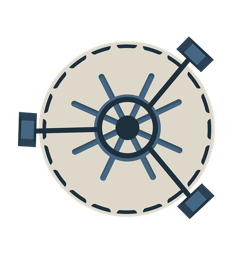

<p align="center"></a></p>
<h1 align="center">Vault of Our Own</h1>
<p align="center">A website for TTRPG groups. The Game Master (GM) keeps the lore, private notes and map in one place; players see only what they should, roll dice on the server (so results can't be faked), and show up as online on their character when they are in the campaign.</p>

**Category:** Web · **Stack:** Flask 3 + Gunicorn · PostgreSQL 16 · Redis 7 · Docker Compose

<p align="center">
  <a href="https://medium.com/@chelsealanna95/vault-of-our-own-48870f8831cf">
    
  </a>
  &nbsp;&nbsp;
  <a href="https://youtu.be/cUwEFsiWkEQ">
    
  </a>
</p>

## Features (MVP)
- Create a campaign (GM) or join with a 6-character code (player)
- Players pick / create their Player Character (PC) before entering
- **Summary** (visible to everyone) and **GM Notes** (GM only) written in Markdown, double-click a panel to open it as a tab in the in-site editor (headings, bold, italic, strikethrough, code, lists, task lists, quotes, links, images, tables, rules; Ctrl+B / Ctrl+I / Ctrl+K / Ctrl+S)
- **Map** visibility toggle
- Roster of **PCs** (with online/offline status), **NPCs** and **Monsters** (GM only)
- Server-side dice rolls stored in PostgreSQL, latest 15 cached in Redis

## Architecture
```
Browser ──► localhost:5000 ──► [app: Flask/Gunicorn] ──vault_net──► [db: PostgreSQL]  (volume pg_data)
                                         └──────────vault_net──► [redis: Redis]       (volume redis_data)
            localhost:8080 ──► [adminer] (profile "tools") ──vault_net──► db
```

## API
| Method | Path | Success |
|---|---|---|
| GET | `/health` | 200 (503 if DB/Redis down) |
| GET | `/api/campaigns` | 200 |
| POST | `/api/campaigns` | 201 |
| POST | `/api/join` | 201 new member / 200 already member / 404 bad code |
| GET | `/api/campaigns/{id}/lore` | 200 (Redis cache-aside; notes removed for players) |
| PATCH | `/api/campaigns/{id}/lore` | 200 (GM only, else 403) |
| GET / POST | `/api/campaigns/{id}/characters` | 200 / 201 |
| POST | `/api/campaigns/{id}/characters/{cid}/claim` | 200 / 409 taken |
| POST | `/api/campaigns/{id}/presence` | 204 |
| POST | `/api/campaigns/{id}/roll` | 201 / 400 invalid die |
| GET | `/api/campaigns/{id}/recent-rolls` | 200 |

## Run on localhost
```bash
git clone https://github.com/chrysan95/vaultofourown.git
cd vaultofourown
cp .env.example .env
docker compose up -d --build
```
Open http://localhost:5000 and pick a demo account in the login dialog (the list comes from the database). The database is created from `db/01-schema.sql` + `db/02-seed.sql` (dummy data only).

Optional DB tools: `docker compose --profile tools up -d`, then Adminer (PostgreSQL) at http://localhost:8080 and RedisInsight (Redis) at http://localhost:5540.

## Credits
Font: Lexend (Google Fonts, OFL). Libraries: Flask, Gunicorn, psycopg, redis-py. Font is self-hosted from `app/static/fonts`. Base images: python, postgres, redis, adminer (Docker Official Images), redis/redisinsight.

## AI Usage Declaration
- **Tool:** Claude, Gemini 
- **Parts assisted:** coding assistance, debugging
- **Main prompt example:** use the same fonts, and assets, you can improvise but dont improvise all of it, font: Lexend

for the campaign dashboard make it so that if you double click you can open a tab in the website and edit with all the classic markdown settings, also make sure that for the players, you can only see the summary, maps can be toggled to everyone sees or only game master. For characters there are NPCs and PCs (PCs have a status to see if the user is currently in the campaign or not)

- **Own work:** Everything was manually tested by me, designs are also by me, this was partially written by me
